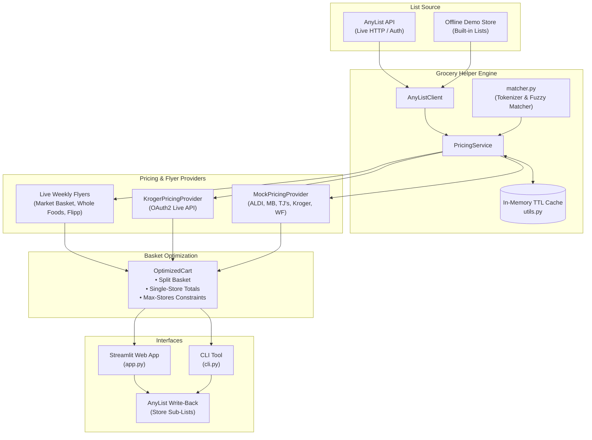

# 🛒 Grocery Helper

A Python library, CLI, and Streamlit application that integrates with **AnyList** to find optimal grocery pricing across stores.

[](https://github.com/cuyler/grocery_helper/actions/workflows/ci.yml)
[](https://cuyler.github.io/grocery_helper/)
[](https://www.python.org/)
[](https://opensource.org/licenses/MIT)

---

## 🌟 Key Features

- **AnyList Integration**: Pulls shopping lists and items directly from your AnyList account, with zero-configuration offline demo mode for quick testing.
- **Multi-Store Pricing & Live Weekly Flyers**:
  - **Live Weekly Sale Circulars**: Fetches real-time advertised weekly sales from **Market Basket** (`/wp-json/mb/v1/weekly-flyer`), **Whole Foods Market** (store-specific `/sales-flyer` with Amazon Prime pricing), and nearby grocery chains for any ZIP code via **Flipp** (e.g. ALDI, Star Market, Shaw's, Stop & Shop, Hannaford, Wegmans, Big Y, Costco, Target, Walmart).
  - **Crowdsourced Shelf Prices (Open Prices)**: Optional integration with Open Food Facts' **Open Prices** (`prices.openfoodfacts.org`) for receipt- and shelf-tag-verified retail prices on non-sale everyday items.
  - **Live Kroger Developer API**: Real-time product search, nearest store locator, and live regular/promotional pricing.
  - **Regional Baseline Pricing Providers**: Deterministic baseline pricing models across **ALDI**, **Market Basket**, **Trader Joe's**, **Kroger**, and **Whole Foods**.
- **Weekly On-Sale Item Browser & List Matcher**:
  - Browse and filter all active weekly sale items across stores, or automatically match weekly circular deals against items on your grocery list.
- **Basket & Route Optimization**:
  - **Cheapest Basket**: Minimizes total grocery spend across all items.
  - **Constrained Stops (`max_stores`)**: Limit shopping stops to $N$ stores (e.g. at most 2 stores) to balance savings against driving convenience.
  - **Store Filtering (`allowed_stores`)**: Exclude grocers you don't frequent.
  - **Single-Store Evaluation**: Calculates the best single-store alternative and cost difference.
- **Smart Item Normalization**: Automatic quantity/unit extraction (e.g. *"Honeycrisp Apples 3 lbs"*) and token fuzzy matching to reconcile free-form AnyList names with store SKUs and flyer deals.
- **AnyList Sync & Sub-List Export**: Update your active AnyList items in-place with assigned stores, prices, categories, and quantities, or automatically export store-specific lists (e.g. *"Weekly Shop (ALDI)"* and *"Weekly Shop (Market Basket)"*) in AnyList.
- **Dual Interfaces**:
  - Interactive **Streamlit Web UI** (`grocery-helper serve`) with a **🏷️ Weekly Sales & Flyers** tab.
  - Scriptable **CLI** (`grocery-helper optimise <list_id>` and `grocery-helper flyers`) with text and JSON outputs.

---

## 🏗️ Architecture



---

## 📁 Project Structure

```
grocery_helper/
├── .github/
│   └── workflows/
│       ├── ci.yml               # Automated formatting, linting, type-check & test
│       └── docs.yml             # MkDocs deployment to GitHub Pages
├── docs/                        # MkDocs documentation site
├── src/
│   └── grocery_helper/
│       ├── __init__.py          # Package version
│       ├── anylist_client.py    # Async AnyList client (live & demo mode)
│       ├── app.py               # Streamlit interactive web application
│       ├── cli.py               # Command-line interface
│       ├── config.py            # Pydantic Settings configuration
│       ├── flyers.py            # Market Basket, Whole Foods & Flipp flyer providers
│       ├── matcher.py           # Quantity parser and fuzzy string matcher
│       ├── models.py            # Pydantic data models
│       ├── open_prices.py       # Open Food Facts Open Prices API client
│       ├── preferences.py       # Non-secret persistent UI settings store
│       ├── pricing.py           # Pricing service, providers, and route optimizer
│       └── utils.py             # Formatting, TTL caching, logging
├── tests/                       # Comprehensive test suite (unit + AppTest)
├── .env.example                 # Configuration template
├── CHANGELOG.md                 # Project release history
├── mkdocs.yml                   # MkDocs Material configuration
└── pyproject.toml
```

---

## 🚀 Quick Start

### Prerequisites
- [uv](https://docs.astral.sh/uv/) (Astral Python package manager)
- Python 3.11+

### Installation & Setup

```bash
# 1. Clone the repository
git clone https://github.com/cuyler/grocery_helper.git
cd grocery_helper

# 2. Copy and configure environment variables (optional for demo mode)
cp .env.example .env

# 3. Install dependencies
uv sync

# 4. Launch the Streamlit web application
uv run grocery-helper serve

# — or directly run the optimization CLI —
uv run grocery-helper optimise list_001 --demo
```

---

## 💻 CLI Usage

The `grocery-helper` CLI allows running optimizations directly in headless environments, terminal workflows, or CI pipelines:

```bash
# Optimize a list in demo mode
grocery-helper optimise list_001 --demo

# Restrict the shopping route to at most 2 store stops
grocery-helper optimise list_001 --demo --max-stores 2

# Filter by specific stores only
grocery-helper optimise list_001 --demo --stores ALDI "Trader Joe's"

# Specify a custom ZIP code for store lookup
grocery-helper optimise list_001 --zip 90210

# Output raw JSON for automation scripts
grocery-helper optimise list_001 --demo --json

# Overlay live weekly flyers and Open Prices crowdsourced shelf prices
grocery-helper optimise list_001 --demo --live-flyers --open-prices --zip 02139

# Browse all live weekly on-sale items & list matches
grocery-helper flyers --demo --list-id list_001 --zip 02139

# Filter Flipp weekly circulars for specific nearby stores and keywords
grocery-helper flyers --store flipp --zip 02139 --merchants Hannaford "Star Market" ALDI --search chicken
```

---

## ⚙️ Configuration

Settings can be specified in `.env` or passed as environment variables:

| Variable | Description | Default |
|---|---|---|
| `ANYLIST_EMAIL` | AnyList account email | `""` |
| `ANYLIST_PASSWORD` | AnyList account password | `""` |
| `DEFAULT_STORE_ZIP` | Default ZIP code for grocer lookups | `""` |
| `DEFAULT_ALLOWED_STORES` | Comma-separated default stores in Allowed Stores | `""` |
| `DEFAULT_MAX_STORES` | Optional default maximum store stops | `""` |
| `ADVERTISED_ONLY` | Restrict live-flyer stores to advertised deals only | `false` |
| `UI_SETTINGS_FILE` | Path to saved non-secret UI preferences JSON | `~/.config/grocery_helper/ui_settings.json` |
| `PRICE_CACHE_TTL_SECONDS` | In-memory price cache duration | `3600` |
| `KROGER_CLIENT_ID` | Kroger Developer API Client ID (optional live data) | `""` |
| `KROGER_CLIENT_SECRET` | Kroger Developer API Client Secret | `""` |
| `ENABLE_LIVE_FLYERS` | Overlay live weekly sale flyers during pricing | `false` |
| `ENABLE_FLIPP` | Include nearby store circulars via Flipp when live flyers are enabled | `true` |
| `ENABLE_OPEN_PRICES` | Overlay crowdsourced retail shelf prices from Open Prices | `false` |
| `OPEN_PRICES_BASE_URL` | Open Food Facts Open Prices REST API base URL | `https://prices.openfoodfacts.org/api/v1` |
| `WHOLE_FOODS_STORE_ID` | Whole Foods store ID for local weekly sales flyer | `10010` |
| `WHOLE_FOODS_PRIME` | Apply Prime member pricing for Whole Foods deals | `true` |
| `MARKET_BASKET_FLYER_URL` | Market Basket weekly flyer JSON endpoint | `https://www.shopmarketbasket.com/wp-json/mb/v1/weekly-flyer` |
| `WHOLE_FOODS_BASE_URL` | Whole Foods Market base URL | `https://www.wholefoodsmarket.com` |
| `FLIPP_BASE_URL` | Flipp weekly flyer & item search base URL | `https://backflipp.wishabi.com/flipp` |
| `APP_TITLE` | Streamlit browser tab title | `Grocery Helper` |
| `DEBUG` | Enable verbose debug logging | `false` |

---

## 🧪 Testing & Code Quality

```bash
# Run full test suite with coverage
uv run pytest

# Check code formatting & linting
uv run ruff check .
uv run ruff format --check .

# Static type checking
uv run mypy src/ tests/
```

---

## 📄 Documentation & Changelog

- **Shopper's Guide (Non-Developer)**: Read our [Everyday Shopper's Guide](docs/guide/user-guide.md) for a simple, non-technical walkthrough of how to save money on groceries.
- **Full Documentation Site**: Published on GitHub Pages via [MkDocs Material](https://cuyler.github.io/grocery_helper/).
- **Release History**: See [CHANGELOG.md](CHANGELOG.md) for detailed notes on each release.
