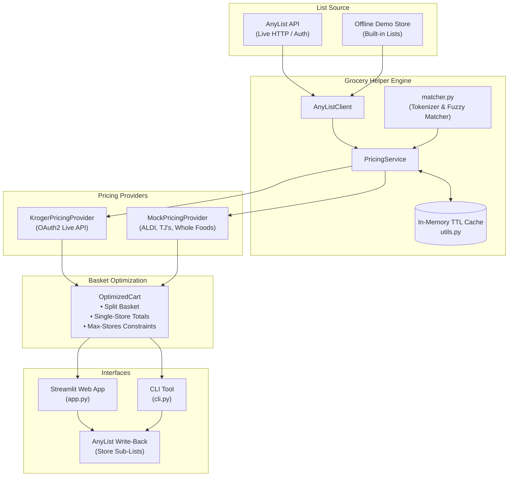

# 🛒 Grocery Helper

A Python library, CLI, and Streamlit application that integrates with **AnyList** to find optimal grocery pricing across stores.

[](https://github.com/cuyler/grocery_helper/actions/workflows/ci.yml)
[](https://cuyler.github.io/grocery_helper/)
[](https://www.python.org/)
[](https://opensource.org/licenses/MIT)

---

## 🌟 Key Features

- **AnyList Integration**: Pulls shopping lists and items directly from your AnyList account, with zero-configuration offline demo mode for quick testing.
- **Multi-Store Pricing**:
  - **Live Kroger Developer API**: Real-time product search, nearest store locator, and live regular/promotional pricing.
  - **Regional Pricing Providers**: Realistic pricing models across **ALDI**, **Trader Joe's**, **Kroger**, and **Whole Foods**.
- **Basket & Route Optimization**:
  - **Cheapest Basket**: Minimizes total grocery spend across all items.
  - **Constrained Stops (`max_stores`)**: Limit shopping stops to $N$ stores (e.g. at most 2 stores) to balance savings against driving convenience.
  - **Store Filtering (`allowed_stores`)**: Exclude grocers you don't frequent.
  - **Single-Store Evaluation**: Calculates the best single-store alternative and cost difference.
- **Smart Item Normalization**: Automatic quantity/unit extraction (e.g. *"Honeycrisp Apples 3 lbs"*) and token fuzzy matching to reconcile free-form AnyList names with store SKUs.
- **AnyList Sub-List Export**: Automatically export your optimized route into store-specific lists (e.g. *"Weekly Shop (ALDI)"* and *"Weekly Shop (Kroger)"*) in AnyList.
- **Dual Interfaces**:
  - Interactive **Streamlit Web UI** (`grocery-helper serve`).
  - Scriptable **CLI** (`grocery-helper optimise <list_id>`) with text and JSON outputs.

---

## 🏗️ Architecture



---

## 📁 Project Structure

```
grocery_helper/
├── .github/
│   └── workflows/
│       ├── ci.yml               # Automated formatting, linting, type-check & test
│       └── docs.yml             # MkDocs deployment to GitHub Pages
├── docs/                        # MkDocs documentation site
├── src/
│   └── grocery_helper/
│       ├── __init__.py          # Package version
│       ├── anylist_client.py    # Async AnyList client (live & demo mode)
│       ├── app.py               # Streamlit interactive web application
│       ├── cli.py               # Command-line interface
│       ├── config.py            # Pydantic Settings configuration
│       ├── matcher.py           # Quantity parser and fuzzy string matcher
│       ├── models.py            # Pydantic data models
│       ├── pricing.py           # Pricing service, providers, and route optimizer
│       └── utils.py             # Formatting, TTL caching, logging
├── tests/                       # Comprehensive test suite (unit + AppTest)
├── .env.example                 # Configuration template
├── CHANGELOG.md                 # Project release history
├── mkdocs.yml                   # MkDocs Material configuration
└── pyproject.toml
```

---

## 🚀 Quick Start

### Prerequisites
- [uv](https://docs.astral.sh/uv/) (Astral Python package manager)
- Python 3.11+

### Installation & Setup

```bash
# 1. Clone the repository
git clone https://github.com/cuyler/grocery_helper.git
cd grocery_helper

# 2. Copy and configure environment variables (optional for demo mode)
cp .env.example .env

# 3. Install dependencies
uv sync

# 4. Launch the Streamlit web application
uv run grocery-helper serve

# — or directly run the optimization CLI —
uv run grocery-helper optimise list_001 --demo
```

---

## 💻 CLI Usage

The `grocery-helper` CLI allows running optimizations directly in headless environments, terminal workflows, or CI pipelines:

```bash
# Optimize a list in demo mode
grocery-helper optimise list_001 --demo

# Restrict the shopping route to at most 2 store stops
grocery-helper optimise list_001 --demo --max-stores 2

# Filter by specific stores only
grocery-helper optimise list_001 --demo --stores ALDI "Trader Joe's"

# Specify a custom ZIP code for store lookup
grocery-helper optimise list_001 --zip 90210

# Output raw JSON for automation scripts
grocery-helper optimise list_001 --demo --json
```

---

## ⚙️ Configuration

Settings can be specified in `.env` or passed as environment variables:

| Variable | Description | Default |
|---|---|---|
| `ANYLIST_EMAIL` | AnyList account email | `""` |
| `ANYLIST_PASSWORD` | AnyList account password | `""` |
| `DEFAULT_STORE_ZIP` | Default ZIP code for grocer lookups | `""` |
| `PRICE_CACHE_TTL_SECONDS` | In-memory price cache duration | `3600` |
| `KROGER_CLIENT_ID` | Kroger Developer API Client ID (optional live data) | `""` |
| `KROGER_CLIENT_SECRET` | Kroger Developer API Client Secret | `""` |
| `APP_TITLE` | Streamlit browser tab title | `Grocery Helper` |
| `DEBUG` | Enable verbose debug logging | `false` |

---

## 🧪 Testing & Code Quality

```bash
# Run full test suite with coverage
uv run pytest

# Check code formatting & linting
uv run ruff check .
uv run ruff format --check .

# Static type checking
uv run mypy src/ tests/
```

---

## 📄 Documentation & Changelog

- **Full Documentation**: Published on GitHub Pages via [MkDocs Material](https://cuyler.github.io/grocery_helper/).
- **Release History**: See [CHANGELOG.md](CHANGELOG.md) for detailed notes on each release.
