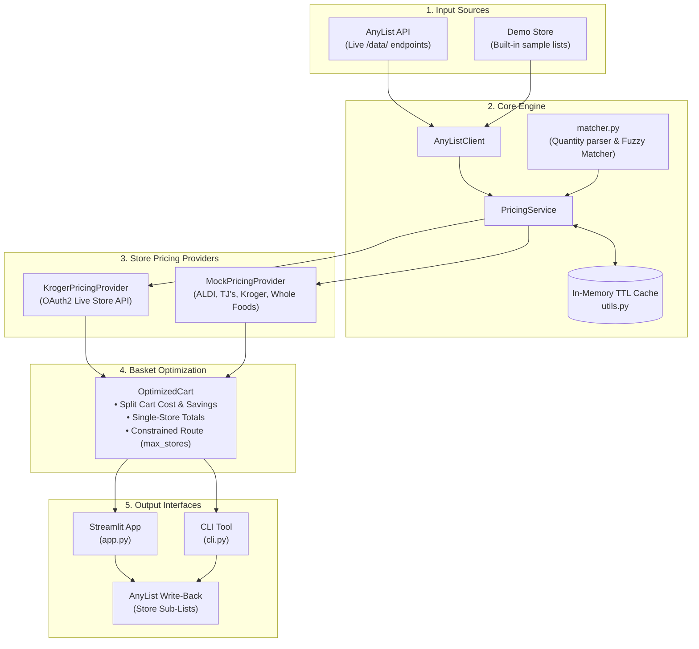

# 🏗️ Architecture & Design

Grocery Helper follows a modular, decoupled architecture centered around Pydantic data models and pluggable providers.

---

## System Diagram

---

## Key Modules

### `grocery_helper.models`
Defines the core domain entities:
- `GroceryItem`: Product identifier, display name, quantity, measurement unit, category, and checked status.
- `GroceryList`: List container with creation and modification timestamps.
- `StorePrice`: Pricing data per store including regular and promotional sale price.
- `PriceComparison`: Cross-store price matrix for a single item.
- `OptimizedCart`: The output of basket optimization, including item-to-store mappings, total basket cost, potential savings, and single-store comparison totals.

### `grocery_helper.anylist_client`
Async HTTP client designed around AnyList's reverse-engineered `/data/` endpoints:
- Generates required `X-AnyLeaf-API-Version: 3` and device UUID `X-AnyLeaf-Client-Identifier` headers.
- Handles user authentication, session token retention, and shopping list CRUD.
- Seamless fallback to `demo_mode` with sample lists (*"Weekly Shop"*, *"Party Supplies"*, *"Brunch & Coffee"*).
- `export_split_lists()` generates store-specific sub-lists back in AnyList.

### `grocery_helper.pricing`
- **`BasePricingProvider`**: Protocol specifying `async def get_prices(item, store_zip) -> list[StorePrice]`.
- **`MockPricingProvider`**: Generates deterministic prices with store price profiles (ALDI, Trader Joe's, Kroger, Whole Foods) based on catalog matching or name hashes.
- **`KrogerPricingProvider`**: Authenticates with Kroger Developer OAuth2, resolves nearest store location by ZIP code, and retrieves live SKU prices.
- **`PricingService`**:
  - In-memory TTL caching with cache keys formatted as `cache_key(item.name, zip)`.
  - Overlays live Kroger prices onto regional store matrices.
  - Computes unconstrained split basket and evaluates `max_stores` combinations using subset cover analysis.

### `grocery_helper.matcher`
Normalizes AnyList user inputs:
- Regex-based quantity and unit parser (e.g. *"Honeycrisp Apples 3 lbs"* $\to$ `3.0`, `Unit.LB`).
- Token overlap and sequence matching score calculation.

