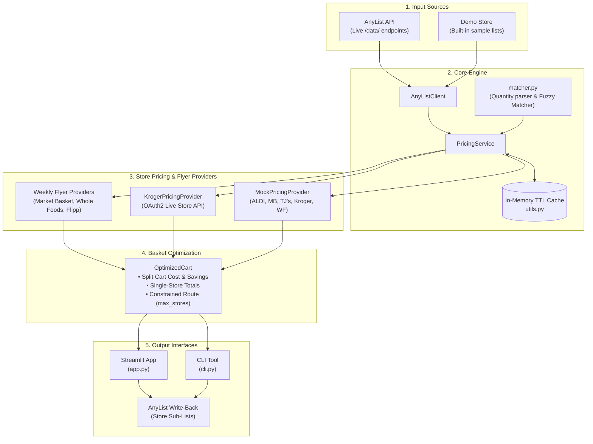

# 🏗️ Architecture & Design

Grocery Helper follows a modular, decoupled architecture centered around Pydantic data models and pluggable providers.

---

## System Diagram

---

## Key Modules

### `grocery_helper.models`
Defines the core domain entities:
- `GroceryItem`: Product identifier, display name, quantity, measurement unit, category, and checked status.
- `GroceryList`: List container with creation and modification timestamps.
- `StorePrice`: Pricing data per store including regular and promotional sale price, plus optional `is_live`, `matched_product_name`, and `deal_details` metadata for live flyer overlays.
- `FlyerDeal`: Advertised weekly flyer item (`store_name`, `product_name`, `regular_price`, `sale_price`, `prime_price`, `unit`, `deal_text`, `valid_from`, `valid_to`, and `effective_sale_price()`).
- `PriceComparison`: Cross-store price matrix for a single item, with unit normalization (`normalized_price()`).
- `OptimizedCart`: The output of basket optimization, including item-to-store mappings, total basket cost, potential savings, and single-store comparison totals.

### `grocery_helper.anylist_client`
Async HTTP client built around AnyList's `/auth/token` and protobuf `/data/` API:
- Generates required `X-AnyLeaf-API-Version: 3` and device UUID `X-AnyLeaf-Client-Identifier` headers.
- Handles multipart `/auth/token` authentication, JWT `sub` user-ID extraction, automatic `/auth/token/refresh` retries, protobuf `/data/user-data/get` decoding, and multipart `operations` uploads to `/data/shopping-lists/update`.
- Seamless fallback to `demo_mode` with sample lists (*"Weekly Shop"*, *"Party Supplies"*, *"Brunch & Coffee"*).
- `export_split_lists()` generates store-specific sub-lists back in AnyList.

### `grocery_helper.flyers`
- **`BaseFlyerProvider`**: Protocol defining `fetch_flyer()` and `get_prices(item, store_zip)`.
- **`MarketBasketFlyerProvider`**: Fetches active Market Basket weekly circulars from `/wp-json/mb/v1/weekly-flyer` and computes sale/regular prices and savings.
- **`WholeFoodsFlyerProvider`**: Extracts store-specific promotions from Whole Foods Market `__NEXT_DATA__` SSR HTML (`sales-flyer?store-id=...`) with support for Amazon Prime pricing and percentage-off promotions.
- **`FlippFlyerProvider`**: Queries Flipp (`backflipp.wishabi.com/flipp`) by ZIP code to discover local grocery circulars and search advertised items across chains.
- **`match_flyer_deals()`**: Token-similarity matcher linking grocery list entries to active circular titles while avoiding substring false positives (e.g., `"milk"` vs. `"buttermilk"`).

### `grocery_helper.pricing`
- **`BasePricingProvider`**: Protocol specifying `async def get_prices(item, store_zip) -> list[StorePrice]`.
- **`MockPricingProvider`**: Generates deterministic baseline prices with store profiles (**ALDI**, **Market Basket**, **Trader Joe's**, **Kroger**, **Whole Foods**).
- **`KrogerPricingProvider`**: Authenticates with Kroger Developer OAuth2, resolves nearest store location by ZIP code, and retrieves live SKU prices.
- **`PricingService`**:
  - Thread-safe TTL caching keyed by provider, flyer settings, item name, unit, and ZIP code.
  - Pre-warms and overlays live flyer prices with clear precedence: **Flipp** (generic local chains) → store-specific **Market Basket** & **Whole Foods** circulars (plus optional `flyer_only_for_live_stores=True` mode).
  - Computes unconstrained split baskets and evaluates `max_stores` combinations using subset cover analysis.

### `grocery_helper.matcher`
Normalizes AnyList user inputs:
- Regex-based quantity and unit parser (e.g. *"Honeycrisp Apples 3 lbs"* $\to$ `3.0`, `Unit.LB`).
- Token overlap and sequence matching score calculation.

