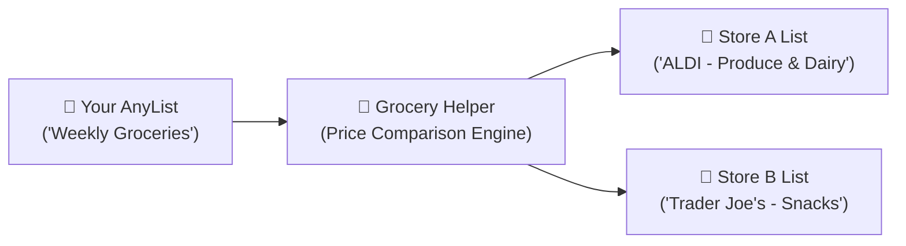

# 🛍️ Shopper's Guide (Non-Developer)

Welcome to **Grocery Helper**! This guide is written for everyday shoppers who want to save money on groceries without spending hours comparing store circulars or flipping between different shopping apps.

---

## 🎯 What Does Grocery Helper Do?

Grocery prices vary wildly between stores. Milk might be \$1.80 cheaper at ALDI, while fresh sourdough is cheaper at Trader Joe's, and your favorite coffee is on sale at Kroger.

**Grocery Helper**:
1. Connects to your **AnyList** grocery list (on your phone or computer).
2. Checks prices across nearby stores (**ALDI**, **Trader Joe's**, **Kroger**, and **Whole Foods**).
3. Tells you the **cheapest single store** to visit if you're in a hurry.
4. Tells you how much more you could save by splitting your trip between **2 or more stores**.
5. Automatically creates **store-specific shopping lists back on your phone** so you can easily check items off while shopping!



---

## 🚀 How to Start the App

You don't need to know how to code to run Grocery Helper.

1. Open your computer's **Terminal** (Mac) or **Command Prompt / PowerShell** (Windows).
2. Type or paste this command and press **Enter**:
   ```bash
   grocery-helper serve
   ```
3. Your web browser will automatically open with the Grocery Helper dashboard (at `http://localhost:8501`).

!!! tip "Closing the App"
    When you are done, simply close your browser window. In your terminal, you can press <kbd>Ctrl</kbd> + <kbd>C</kbd> to stop the app.

---

## 🧭 Step-by-Step Walkthrough

When the web app opens, you'll see a clean shopping dashboard with a sidebar on the left and your shopping lists on the right.

### Step 1: Choose Demo Mode or Connect Your AnyList Account

- **Just Want to Try It Out?**
  Keep **Demo Mode** checked in the left sidebar! The app comes preloaded with sample lists (*"Weekly Shop"*, *"Party Supplies"*, and *"Brunch & Coffee"*) so you can test all features without entering any credentials.
- **Ready to Use Your Own Lists?**
  In the left sidebar, uncheck **Demo Mode** and enter your AnyList **Email** and **Password**. Your lists will automatically appear in the dropdown menu.

> [!NOTE]
> Your AnyList password is stored only on your computer in your local configuration and is never sent to third-party tracking servers.

---

### Step 2: Choose Your Local Stores

Not everyone has every grocery store nearby. In the sidebar under **"Allowed Stores"**:
- Check the stores you are willing to shop at (e.g., **ALDI**, **Trader Joe's**, **Kroger**).
- Uncheck any stores that aren't near you or that you don't prefer.

You can also enter your **ZIP Code** to automatically find the closest branch locations.

---

### Step 3: Choose Your Trip Style ("Max Stores" Slider)

How much time do you have to shop this week? Use the **"Max Store Stops"** slider to set your preference:

| Slider Setting | What It Means | Best For |
|---|---|---|
| **1 Store** | Finds the **single cheapest store** for your entire basket. Zero extra driving. | Busy weekdays or quick errands. |
| **2 Stores** | Splits your basket across the top 2 stores to unlock major savings while keeping driving manageable. | The sweet spot for weekly shopping! |
| **3+ Stores** | Finds the absolute rock-bottom price across every store. | Maximum possible budget savings. |

---

### Step 4: Review Your Savings & Price Comparisons

Click the **Price Comparison** tab to see a breakdown of your list:
- Each item is shown alongside its price at every selected store.
- **Green badges** highlight promotional sales and discounts.
- The **Cheapest Store** column shows you exactly where to buy each item.
- The **Savings** column shows how much you save on each product compared to the highest-priced store.

---

### Step 5: Add Extra or Forgotten Items

Realized you forgot something while reviewing prices?
1. Click the **"➕ Add an Item to this List"** box above the tabs.
2. Type in the item name (e.g. *"Greek Yogurt"* or *"Honeycrisp Apples"*).
3. Choose the quantity and unit (e.g. `2`, `lb`).
4. Click **"Add to List"**.

The app immediately refreshes with the updated totals and savings!

---

### Step 6: Export Custom Lists to Your Phone

Once you're happy with your shopping plan, switch to the **Optimised Cart** tab:
1. Review your total spend, your estimated savings, and the items assigned to each store.
2. Click the big green button: **"📤 Export Store Lists to AnyList"**.
3. Open the **AnyList app on your iPhone or Android**.

You will find new, beautifully organized sub-lists (for example, *"Weekly Groceries (ALDI)"* and *"Weekly Groceries (Trader Joe's)"*). When you walk into ALDI, open your ALDI list and check off items as you go!

---

## 📝 Tips for Writing Items in AnyList

Grocery Helper includes a smart matching engine that automatically detects item sizes, units, and spelling. Follow these simple tips when adding items to your grocery list for the most accurate prices:

### Include Quantities and Units
If you know how much you need, include the quantity right in the item title:
- `"Honeycrisp Apples 3 lbs"`
- `"Whole Milk 1 gal"`
- `"Diet Coke 12pk"`
- `"Eggs 1 dozen"` (or `"Eggs 12ct"`)

### Specify Varieties or Organic
If you prefer organic or specific varieties, mention it:
- `"Organic Bananas"` vs. `"Bananas"`
- `"Sourdough Bread"` vs. `"Bread"`
- `"Boneless Skinless Chicken Breast"` vs. `"Chicken"`

### Don't Worry About Minor Typos
The matching engine automatically corrects minor spelling differences (e.g., *"avacados"*, *"spinich"* or abbreviations like *"Coffee w/ milk"*).

---

## ❓ Frequently Asked Questions (FAQ)

### Do I need a paid AnyList subscription?
**No.** Grocery Helper works with both free AnyList accounts and AnyList Complete (paid) accounts.

### What if I don't have an AnyList account?
You can still use Grocery Helper completely free in **Demo Mode**! It will give you realistic price comparisons, route optimizations, and savings estimates using built-in grocery lists.

### How does Grocery Helper know grocery prices?
- **Live Store APIs**: For supported chains like Kroger (and its family of stores like Ralphs, Dillons, King Soopers, Fred Meyer), Grocery Helper connects directly to live product catalogs and weekly sale circulars.
- **Regional Price Models**: For chains like ALDI and Trader Joe's, Grocery Helper uses calibrated regional grocery price benchmarks that reflect everyday retail pricing.

### What if a store doesn't carry an item on my list?
If an item isn't available at a specific store, Grocery Helper flags it and automatically assigns that item to another store on your route that does carry it.

### Can I run this without an internet connection?
Yes! In **Demo Mode**, Grocery Helper works 100% offline without needing an active internet connection.

